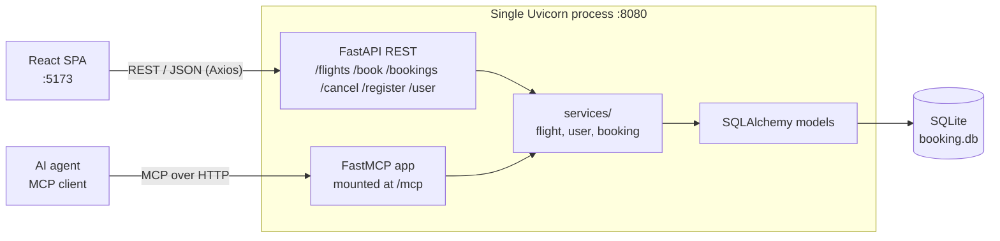
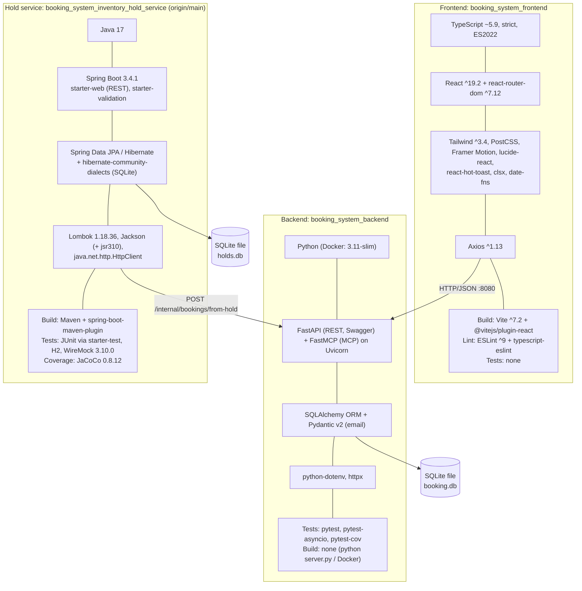
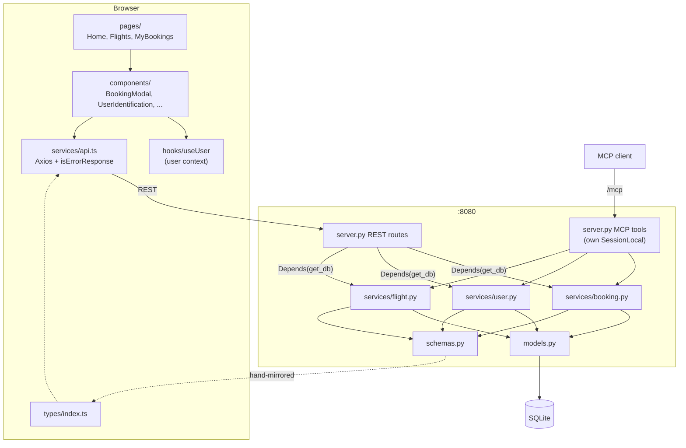
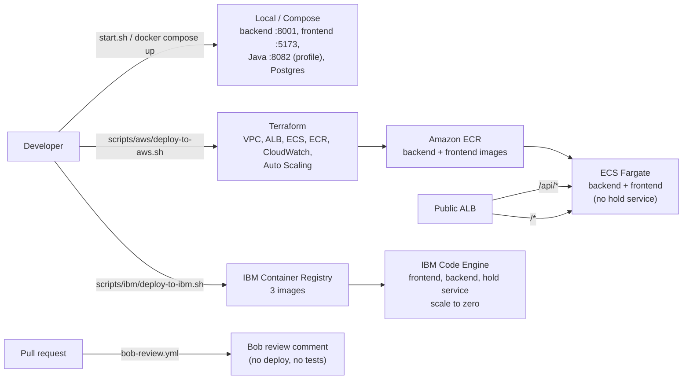

# Galaxium Travels: Onboarding Guide

Findings from analyzing the repository at branch `bob-learning-path-branch`. Everything here comes from files in the repo.

> **Missing from this checkout.** These paths were referenced but do not exist, so nothing is documented about them beyond this note:
> `booking_system_inventory_hold_service/` (Java; present on `origin/main`, so section 2 now covers it), `tests_e2e/` (the e2e suite is `e2e/` on `origin/main`), `docker-compose.yml`, the deploy scripts, Terraform, `.github/workflows/` and a frontend `Dockerfile` (all present on `origin/main`; section 6 now covers them under `scripts/aws`, `scripts/ibm` and `scripts/terraform`), a `docs/` directory (before this file), and `start.bat`.
> If they live on another branch, re-run the analysis against it.

## Contents

1. [Application overview](#1-application-overview)
2. [Tech stack analysis](#2-tech-stack-analysis)
3. [Key components and interactions](#3-key-components-and-interactions)
4. [Unit test coverage](#4-unit-test-coverage)
5. [End-to-end test coverage](#5-end-to-end-test-coverage)
6. [Deployment model](#6-deployment-model)

---

## 1. Application overview

### Purpose

Galaxium Travels is a demo full-stack app for booking interplanetary flights between Earth, Mars, the Moon, Venus, Jupiter, Europa and Pluto. Users can:

- register or sign in with a name and email
- browse flights
- book a seat
- view their bookings
- cancel a booking

The backend exposes the same operations over **REST** (for the web UI) and **MCP** (for AI agents). The repo appears to be a tutorial or sample project for Bob.

### Project structure

```
galaxium-travels/
├── booking_system_backend/      FastAPI + FastMCP + SQLAlchemy (Python)
│   ├── server.py                REST routes, MCP tools, CORS, lifespan
│   ├── services/                booking.py, user.py, flight.py (business logic)
│   ├── models.py                ORM tables: User, Flight, Booking
│   ├── schemas.py               Pydantic request/response models
│   ├── db.py                    engine, SessionLocal, init_db, get_db
│   ├── seed.py                  demo data
│   ├── tests/                   conftest.py, test_services.py, test_rest.py
│   ├── Dockerfile, requirements.txt, pytest.ini
├── booking_system_frontend/     React 19 + TypeScript + Vite + Tailwind
│   └── src/ pages/ components/ services/ hooks/ types/ utils/
├── .bob/                        Bob modes and rules
├── internal-monologue/          per-interaction summaries (project rule)
├── start.sh                     starts both services locally
├── AGENTS.md, README.md, LICENSE, .gitignore
```

### High-level architecture



### Top-level directory responsibilities

| Path | Responsibility |
|---|---|
| `booking_system_backend/` | Python backend: REST + MCP transports, business logic, persistence, tests. |
| `booking_system_frontend/` | Web UI: routing, pages, components, API client, user session context. |
| `start.sh` | Creates the Python venv, installs dependencies, and starts the backend (:8080) and frontend (:5173). |
| `.bob/` | Bob configuration: `custom_modes.yaml` and per-mode rules. |
| `internal-monologue/` | Timestamped summaries of each interaction (required by `basic_rules.md`). |
| `AGENTS.md` | Guidance for AI agents working in the repo. |
| `README.md`, `LICENSE`, `.gitignore` | Docs, license, ignore rules. |

### Backend internals

| File | Role |
|---|---|
| `server.py` | Defines the `FastMCP` instance **before** the `FastAPI` app (required to combine lifespans), the REST routes, six `@mcp.tool()` wrappers, CORS, and the `/mcp` mount. The `lifespan` hook runs `init_db()` then `seed()` on every start. |
| `services/*.py` | All business rules. Functions **return** `ErrorResponse` instead of raising. |
| `models.py` | `User(user_id, name, email unique)`, `Flight(flight_id, origin, destination, departure_time, arrival_time, price, seats_available)`, `Booking(booking_id, user_id FK, flight_id FK, status, booking_time)`. Times are ISO strings. |
| `schemas.py` | `FlightOut`, `BookingRequest`, `BookingOut`, `UserRegistration` (`EmailStr`), `UserOut`, `ErrorResponse`. Uses Pydantic v2 `from_attributes`. |
| `db.py` | SQLite at `./booking.db`, `check_same_thread=False`. |

### Frontend internals

| Area | Role |
|---|---|
| `App.tsx` | `BrowserRouter` + `UserProvider` + `Layout`. Routes: `/` Home, `/flights`, `/bookings`, `*` falls back to Home. |
| `pages/` | `Home`, `Flights`, `MyBookings`. |
| `components/` | `layout/` (Header, Footer, Layout), `flights/`, `bookings/` (BookingCard, BookingModal), `user/` (UserIdentification), `common/` (Button, Card, Input, Modal, LoadingSpinner, Starfield). |
| `services/api.ts` | Axios client; one function per endpoint; `isErrorResponse`. |
| `hooks/useUser.tsx` | User context: `user`, `setUser`, `logout`. |
| `types/index.ts` | TypeScript mirror of backend schemas. |

### Demo data

`seed()` loads 10 users, 10 flights and 20 bookings on every startup.

---

## 2. Tech stack analysis

> The Java inventory hold service is **not on the current branch** (`bob-learning-path-branch`). Its details come from `origin/main`, where it lives in `booking_system_inventory_hold_service/`. It is also on `origin/demo/java-premium-legacy`, `origin/course/reference` and `origin/course/part1-complete`.

### Stack at a Glance



### Per-service detail

| Aspect | Backend | Frontend | Hold service (Java) |
|---|---|---|---|
| Language | Python with type hints | TypeScript ~5.9.3 (`strict`, `noUnusedLocals`, `erasableSyntaxOnly`) | Java 17 (`java.version`, compiler source/target 17) |
| Runtime version | Docker uses `python:3.11-slim`; README says 3.8+; **not enforced** | README says Node 18+; **no `engines` field**; Vite 7 likely needs Node 20.19+ or 22.12+ (from memory, not verified in the repo) | JDK 17+, enforced by the pom and checked in `start-java-service.sh`; Maven 3.6+ for local builds |
| Framework | FastAPI, FastMCP, Uvicorn | React ^19.2.0, React Router ^7.12.0 | Spring Boot 3.4.1 (parent POM `spring-boot-starter-parent`) |
| Key libraries | `sqlalchemy`, `pydantic[email]`, `python-dotenv`, `httpx` | `axios`, `framer-motion`, `tailwindcss`, `lucide-react`, `react-hot-toast`, `date-fns`, `clsx` | `spring-boot-starter-web`, `-data-jpa`, `-validation`; `lombok` 1.18.36; `jackson-databind` + `jackson-datatype-jsr310`; JDK `java.net.http.HttpClient` for calls to the Python backend |
| Database | SQLite (`./booking.db`); `create_all` on startup; no migrations | None; talks to the backend via `VITE_API_URL` (default `http://localhost:8080`) | SQLite (`./holds.db`) via `org.xerial:sqlite-jdbc` 3.44.1.0 and `SQLiteDialect`; `ddl-auto=update`, no migration tool. H2 in memory for tests. |
| Build | None; `python server.py` or Docker | Vite; `npm run build` runs `tsc -b && vite build` | Maven: `mvn clean package` builds an executable jar `inventory-hold-service-1.0.0.jar`; Lombok annotation processor configured; Lombok excluded from the jar |
| Test tooling | pytest, pytest-asyncio, pytest-cov | None; only `npm run lint` and the build's type check | `spring-boot-starter-test` (JUnit 5, Mockito), H2 2.x, WireMock `wiremock-jetty12` 3.10.0; JaCoCo 0.8.12 (`prepare-agent`, report at the `test` phase) |
| Lint | none configured | ESLint 9 with react-hooks and react-refresh plugins | none configured |
| Default port | 8080 | 5173 (dev) | `server.port=8080` in `application.properties`; `start-java-service.sh` overrides to **8082** |
| Container | `python:3.11-slim` single stage | none in repo | Two-stage: `maven:3.9-eclipse-temurin-17` build, then `eclipse-temurin:17-jre-alpine` runtime (overridable by `RUNTIME_IMAGE`); SQLite at `/app/data/holds.db` |

### Hold service configuration (`application.properties`)

| Property | Value |
|---|---|
| `spring.application.name` | `inventory-hold-service` |
| `python.backend.url` | `${PYTHON_BACKEND_URL:http://localhost:8001}` |
| `hold.duration.minutes` | `15` |
| `hold.expiration.check.interval.seconds` | `60` (drives `HoldExpirationScheduler`) |
| `spring.jpa.hibernate.ddl-auto` | `update` |
| Logging | `com.galaxium.holdservice` at `DEBUG` |
| Jackson | dates not written as timestamps; time zone UTC |

### Hold service code layout (`com.galaxium.holdservice`)

| Package | Contents |
|---|---|
| `api/` | `HoldController`, `QuoteController`, `HealthController`, `dto/CreateQuoteRequest` |
| `service/` | `HoldService`, `QuoteService`, `PricingService` |
| `domain/` | `Hold`, `Quote`, `AuditEvent` JPA entities |
| `repository/` | `HoldRepository`, `QuoteRepository`, `AuditEventRepository` |
| `client/` | `PythonBackendClient`, which POSTs to `/internal/bookings/from-hold` |
| `scheduler/` | `HoldExpirationScheduler` |

Other files in the service folder: `spec.md`, `README.md`, `IMPLEMENTATION_SUMMARY.md`, `docs/MODERNIZATION.md`, `start-java-service.sh`.

### Integration with the Python backend

- The hold service calls the Python backend over HTTP to create a booking from a confirmed hold: `POST {python.backend.url}/internal/bookings/from-hold`. It uses a 10 s connect timeout and a 30 s request timeout, and throws `BookingCreationException` on any non-2xx response.
- **This endpoint does not exist in the Python `server.py` on the current branch.** It is not among the REST routes listed in section 3. Check `origin/main`'s backend before relying on it.
- The two services use **different default URLs for the same backend**: `http://localhost:8001` (properties file and start script), `http://python-backend:8000` (Dockerfile env var), while the Python backend itself listens on `8080`. These must be aligned through `PYTHON_BACKEND_URL`.
- The hold service keeps its own database (`holds.db`), separate from `booking.db`. Seat counts remain in `Flight.seats_available` in the Python database.

### Stack concerns

- **Unpinned backend dependencies.** `requirements.txt` has no versions and there is no lock file.
- **Test packages ship with runtime packages.** pytest and its plugins are in the same `requirements.txt` as the runtime packages.
- **No `engines` declared** in `package.json`.
- **`datetime.utcnow()`** is used in the booking service, which is deprecated in recent Python versions.
- **`start.sh` needs bash**, `python3` and `node`.
- **Hold service:**
  - `sqlite-jdbc` 3.44.1.0 and `wiremock-jetty12` 3.10.0 are pinned explicitly. Check them against current releases and CVEs.
  - `hibernate-community-dialects` has no version and is resolved by the Spring Boot BOM.
  - Port, URL and path defaults disagree across files (see the integration list above).
  - The Dockerfile image `eclipse-temurin:17-jre-alpine` is not from the Red Hat registry (project security rule), and sets no non-root `USER`.
  - The Dockerfile's `mvn clean package -DskipTests` skips tests in the image build.
  - `start.sh` at the repo root does not start this service. It has its own `start-java-service.sh`.

---

## 3. Key components and interactions

### Component responsibilities

| Component | File | Responsibility |
|---|---|---|
| API client | `booking_system_frontend/src/services/api.ts` | Axios instance, one function per endpoint. The response interceptor rejects with `error.response.data`, or with a synthetic `NETWORK_ERROR` object. |
| Transport | `booking_system_backend/server.py` | REST routes and MCP tool wrappers, both thin; CORS; startup `init_db` + `seed`. |
| Service layer | `booking_system_backend/services/` | All business rules, returning `Model \| ErrorResponse`. |
| Persistence | `booking_system_backend/models.py` | `users`, `flights`, `bookings` tables. |
| Contract types | `schemas.py` and `types/index.ts` | Request/response shapes, **mirrored by hand**. |

### Component interaction map



### Booking lifecycle

```mermaid
sequenceDiagram
    participant UI as React UI
    participant API as api.ts
    participant S as server.py
    participant B as services/booking.py
    participant DB as SQLite

    Note over UI,DB: Identify user: POST /register or GET /user?name=&email=
    UI->>API: bookFlight({user_id, name, flight_id})
    API->>S: POST /book
    S->>B: book_flight(db, user_id, name, flight_id)
    B->>DB: flight exists? seats_available >= 1?
    B->>DB: user_id AND name match?
    B->>DB: seats_available -= 1; INSERT booking(status="booked")
    B-->>S: BookingOut or ErrorResponse
    S-->>API: HTTP 200 + JSON
    API-->>UI: Booking, or ErrorResponse (success=false)

    UI->>API: getUserBookings(user_id)
    API->>S: GET /bookings/{user_id}

    UI->>API: cancelBooking(id)
    API->>S: POST /cancel/{id}
    S->>B: cancel_booking
    B->>DB: seats_available += 1; status="cancelled"
```

**`book_flight` check order:** `FLIGHT_NOT_FOUND`, then `NO_SEATS_AVAILABLE`, then `NAME_MISMATCH` or `USER_NOT_FOUND`.
**`cancel_booking` errors:** `BOOKING_NOT_FOUND`, `ALREADY_CANCELLED`.
**`register_user` error:** `EMAIL_EXISTS`.
**`get_user` error:** `USER_NOT_FOUND`.

### Cross-service contracts to respect before changing code

| # | Contract | Why it matters |
|---|---|---|
| 1 | **Business errors return HTTP 200** with `success: false`, `error`, `error_code`, `details` in the body. | The frontend uses `isErrorResponse()` (`response.success === false`), not the HTTP status. Switching to HTTP error codes breaks every error path. |
| 2 | **Services return `ErrorResponse`; they don't raise.** | REST callers return it as-is; MCP wrappers convert it with `raise Exception(result.details or result.error)`. |
| 3 | **MCP tools open their own `SessionLocal()`** with try/finally close. | `Depends(get_db)` doesn't work outside the FastAPI request lifecycle. |
| 4 | **`FastMCP` must be created before `FastAPI`**, and `mcp.http_app()` called before `app = FastAPI(...)`. | Required to combine lifespans. |
| 5 | **`schemas.py` and `types/index.ts` are hand-mirrored.** | Nothing generates or checks one from the other. |
| 6 | **`Booking.status` is a free string.** The backend writes `"booked"` or `"cancelled"`. TypeScript also allows `'completed'`. | Mismatch is unenforced. |
| 7 | **Booking identity is `user_id` + `name`.** | A weak check, not authentication. Any caller who knows a `booking_id` can cancel it. |
| 8 | **Seat count is `Flight.seats_available`**, changed in the same transaction as the booking row. | Read, check and decrement are not atomic, so the last seat can be oversold under concurrency. |
| 9 | **Startup runs `init_db()` + `seed()` every time.** | Check `seed.py` for idempotency; tests patch `seed` to a no-op. No migrations: schema changes mean deleting `booking.db`. |
| 10 | **Pydantic v2:** use `Model.model_validate(orm_obj)`, not `.from_orm()`. | Schemas use `Config.from_attributes = True`. |
| 11 | **Tailwind tokens:** use `space-dark`, `space-blue`, `cosmic-purple`, `nebula-pink`, `alien-green`, `solar-orange`, `star-white`. | Project rule; avoid raw hex values. |
| 12 | **API base URL** comes from `VITE_API_URL`, baked in at build time. | Each environment needs its own frontend build. |

### Server hygiene issues

- `server.py` binds `uvicorn.run(..., host="0.0.0.0")`, which conflicts with the project security rule to bind to `127.0.0.1`. Binding to all interfaces is needed inside a container, so decide per environment.
- CORS is `allow_origins=["*"]` combined with `allow_credentials=True`.

### Inventory hold service

`booking_system_inventory_hold_service/` (Java, `com.galaxium.holdservice`) is **not in this checkout**. Nothing in the backend or frontend calls it. If it is added, it must coordinate with `Flight.seats_available` or take it over; otherwise holds and seat counts will drift.

---

## 4. Unit test coverage

### Overview

| Service | Framework | Test files | Status |
|---|---|---|---|
| Backend | pytest | `tests/conftest.py`, `test_services.py`, `test_rest.py`; about 26 tests | Tested |
| Frontend | None | 0 | **Untested** |
| Inventory hold service | n/a | n/a | Not in the repo |

### Backend structure

- Config in `pytest.ini`: `testpaths = tests`, `-v --tb=short`.
- `conftest.py` provides:
  - an in-memory SQLite engine with `StaticPool` (tables created and dropped per test)
  - a `db_session` fixture
  - a `client` fixture (FastAPI `TestClient`) that overrides `get_db`, patches `SessionLocal` in `db` and `server`, and no-ops `seed`
  - three sample-data fixtures, of which `sample_flight_data` and `sample_booking_data` are unused
- Test classes are grouped per feature. Each file repeats `sys.path.insert(0, parent)` because there is no package install.
- **Tests must run from `booking_system_backend/`.**

### What is tested

| File | Layer | Coverage |
|---|---|---|
| `test_services.py` | Service functions | **Flights:** empty list, list with data. **Users:** register OK, `EMAIL_EXISTS`, get OK, `USER_NOT_FOUND`. **Booking:** success with seat decrement, `FLIGHT_NOT_FOUND`, `NO_SEATS_AVAILABLE`, `USER_NOT_FOUND`, `NAME_MISMATCH`. **Cancel:** success with seat restore, `BOOKING_NOT_FOUND`, `ALREADY_CANCELLED`. **List bookings:** with data, empty. |
| `test_rest.py` | HTTP endpoints | `/flights`, `/register`, `/user`, `/book`, `/bookings/{id}`, `/cancel/{id}`, `/`. Asserts that errors return 200 with `success == False`. |

All `ErrorResponse` codes in the service layer are exercised at the service level.

### Gaps

| Priority | Gap |
|---|---|
| High | **MCP layer untested.** The six `@mcp.tool()` wrappers (error-to-exception conversion, own `SessionLocal`) and the `/mcp` mount have no tests. |
| High | **REST error paths thin.** `/book` over HTTP is tested for success and `FLIGHT_NOT_FOUND` only. `NO_SEATS_AVAILABLE`, `NAME_MISMATCH`, `USER_NOT_FOUND` and `ALREADY_CANCELLED` are untested over HTTP. The cancel success test doesn't check the seat restore. |
| Medium | **Input validation untested.** No test for an invalid email (`EmailStr`), a missing field, or a 422 response. |
| Medium | **Seat-counter edge cases.** No test for booking the last seat, cancel then rebook, or concurrency. |
| Medium | **Cross-user cancel.** No ownership check exists, and no test covers it. |
| Low | `seed.py` and `db.init_db` are never tested; `get_bookings` isn't tested for excluding other users' bookings; no coverage threshold. |

### Frontend

- No test framework: no test script, no Vitest, Jest or Testing Library, and no `*.test.*` or `*.spec.*` files under `src/`.
- The only automated checks are `npm run lint` and `npm run build` (`tsc -b` + Vite).
- **Untested critical logic:**
  - `api.ts`: the error interceptor and `isErrorResponse`
  - `useUser.tsx`: login and logout state
  - `BookingModal` and `UserIdentification`: the booking and sign-in flows
  - `MyBookings` and `Flights`: filtering and cancel handling
  - `formatters.ts`: pure functions, easy to test

### Suggested order

1. MCP tool tests, using the `fastmcp` in-process client or calling the tool functions directly.
2. The missing REST error-path tests plus a 422 validation test.
3. A last-seat and cancel-then-rebook test.
4. Add Vitest and Testing Library; start with `api.ts`, `useUser` and `formatters.ts`.

---

## 5. End-to-end test coverage

**No end-to-end or integration suite exists in this checkout.** There is no `tests_e2e/`, no Playwright, Cypress, Vitest or Jest config, no compose file, and no CI. The nearest thing is the backend `test_rest.py`, which runs in-process.

### Cross-service flow coverage

| Flow | Covered? | Where |
|---|---|---|
| Browser UI to REST (`api.ts` to FastAPI) | No | No test drives the UI or the Axios client. |
| REST endpoint to service layer to SQLite | Yes, in-process only | `test_rest.py` |
| Service layer to SQLite, directly | Yes | `test_services.py` |
| AI agent to MCP (`/mcp`) to service layer | No | No test calls a tool or the mount. |
| Full lifecycle via UI (register, book, list, cancel) | No | Pieces are tested separately on the backend only. |
| Frontend types vs backend schemas | No | Hand-mirrored with no check. |
| Booking service to inventory hold service | n/a | The service doesn't exist here. |

### What the tests assert at the boundary

`test_rest.py` asserts:

- Successes and business errors both return **HTTP 200**.
- Errors carry `success == False` and a specific `error_code`: `EMAIL_EXISTS`, `USER_NOT_FOUND`, `FLIGHT_NOT_FOUND`, `BOOKING_NOT_FOUND`.
- Success bodies contain the expected fields (`user_id`, `status` `"booked"` or `"cancelled"`, `origin` and `destination`).
- `/` returns `{"status": "OK"}`.

These assertions encode the contract `isErrorResponse` relies on. Nothing on the frontend side verifies the other half. No test checks headers, CORS, or 422 responses.

### Infrastructure the current suite needs

| Needed | Not needed |
|---|---|
| Python and pytest, run from `booking_system_backend/` | A running backend or frontend |
| FastAPI `TestClient` (in-process) | A browser |
| In-memory SQLite with `StaticPool` | Docker |
| Monkeypatches on `SessionLocal`, `get_db` and `seed` | A network port |

Because of this, the suite never exercises real HTTP, CORS preflight, the `0.0.0.0:8080` binding, the `/mcp` mount, the real lifespan with `init_db` + `seed`, or the file-based `booking.db`.

### What a real e2e suite would need

- Both servers running (via `start.sh` or compose), with a fresh `booking.db` per run, since `seed()` runs on every start.
- A browser driver (Playwright or Cypress) and a fixed `VITE_API_URL`.
- Flows to cover:
  - register or sign in, book, see it in "My Bookings", cancel, then see the seat count return on `/flights`
  - MCP tool calls against the live `/mcp`
  - UI error display for a full flight and a name mismatch
- A contract check that compares the `/openapi.json` schema with `types/index.ts`.
- If the hold service is added, contract tests for hold, confirm, release and expiry.

---


## 6. Deployment model

> **Branch note.** The deployment assets are **not on the current branch** (`bob-learning-path-branch`), which has only the backend `Dockerfile`. They are on `origin/main`. The folders you named (`deployment_scripts/aws`, `deployment_scripts/ibm`, `terraform/`) do not exist under those names. On `origin/main` they are **`scripts/aws/`**, **`scripts/ibm/`** and **`scripts/terraform/`**, and the CI workflow is `.github/workflows/bob-review.yml`. A different workflow, `ci.yml`, exists on `origin/course/reference` and `origin/course/part1-complete`. Everything below was read from `origin/main` unless stated.

### Deployment targets

Three deployment targets exist, plus two helper paths.

| # | Target | Entry point | Runs | Database | Status |
|---|---|---|---|---|---|
| 1 | **Local / Docker Compose** | `start.sh` (wraps `scripts/local/start_locally.sh`) or `docker-compose.yml` | Backend (:8001), frontend (:5173), optional Java hold service (:8082, profile `hold-service`) | PostgreSQL 14 in compose; SQLite when run natively | Implemented |
| 2 | **AWS** (ECS Fargate, Terraform) | `scripts/aws/deploy-to-aws.sh` | **Backend and frontend only** | Embedded SQLite in each task | Implemented, with caveats below |
| 3 | **IBM Cloud Code Engine** | `scripts/ibm/deploy-to-ibm.sh` (and `deploy-to-ibm-simple.sh`) | **Backend, frontend and Java hold service** | Embedded SQLite | Implemented, with caveats below |
| - | E2E stack (test helper) | `e2e/docker-compose.e2e.yml`, `e2e/run-native.sh` | Backend (:18001) and Java service (:18082), SQLite, 1-minute holds | SQLite | Test only |
| - | Static hosting (Vercel or Netlify) | Frontend README | Frontend `dist/` only | n/a | Documented only |

### Target comparison

| Aspect | Local / Compose | AWS ECS Fargate | IBM Code Engine |
|---|---|---|---|
| Provisioning | `docker compose up` | Terraform (`scripts/terraform/`, AWS provider `~> 5.0`, Terraform `>= 1.0`) | `ibmcloud ce` CLI commands in a script, no IaC |
| Image registry | local build | Amazon ECR (`galaxium-booking-backend`, `-frontend`), scan on push, AES256, keep last 10 images | IBM Container Registry (`<region>.icr.io/galaxium`), via registry secret |
| Services deployed | postgres, backend, frontend, java-service (optional) | backend, frontend | backend, frontend, hold-service |
| Ingress and routing | host ports 8001 / 5173 / 8082 | One public ALB. `/api/*` goes to the backend target group, `/*` to the frontend. | One public HTTPS URL per app. The frontend's nginx proxies `/api/` to the backend. |
| Service-to-service | compose DNS (`backend`, `java-service`) | none (no hold service) | `http://<app-name>` inside the project (`--visibility project` for the Java app) |
| Scaling | none | Application Auto Scaling, **min 0 / max 4**, target tracking on ALB requests per target (100), scheduled scale down to 0 at 02:00 UTC and up at 08:00 UTC | `--min-scale 0 --max-scale 3`; scale-down delay 1800 s (backend, Java) |
| Sizing | n/a | 256 CPU units / 512 MB per task (Fargate) | backend and frontend 0.25 vCPU / 0.5 GB; Java 0.5 vCPU / 1 GB |
| Networking | compose network | VPC `10.0.0.0/16`, 2 public and 2 private subnets, IGW, optional NAT, 2 security groups | Managed by Code Engine |
| Logging | container logs | CloudWatch log groups (`/ecs/galaxium-booking-*`), 7 days (30 in prod) | `ibmcloud ce application logs` |
| Idle cost | n/a | ALB (and NAT if enabled) still billed at zero tasks; the script estimates about $78/month for NAT, ALB and Fargate | about $0 when scaled to zero (script estimate) |
| Teardown | `docker compose down` | `scripts/aws/teardown-aws.sh` (destroys everything, deletes ECR images) | `scripts/ibm/teardown-ibm.sh` (deletes apps only; keeps project, registry and images) |
| Extras | `scripts/local/test-containers.sh` | `scale-to-zero.sh`, `scale-up.sh` | `check-ibm-status.sh` |

### How each service is containerized (`origin/main`)

| Service | Base image(s) | Port | Notes |
|---|---|---|---|
| Backend | `python:3.11-slim`, pinned to `linux/amd64` | 8080 | Installs `requirements.txt` first for layer caching, then `COPY . .`. Runs `uvicorn server:app --host 0.0.0.0 --port 8080`. A `HEALTHCHECK` calls `/`. `.dockerignore` excludes `*.db`, `.venv/`, `tests/`, `.env`. |
| Frontend | build `node:18-alpine`, run `nginx:alpine`, both `linux/amd64` | 8080 | `npm ci`, then `npm run build` with `ARG VITE_API_URL=/api` (same-origin default). nginx serves `dist/`, has an SPA fallback, `/health`, gzip, security headers, and a one-year cache for static assets. |
| Java hold service | build `maven:3.9-eclipse-temurin-17`, run `eclipse-temurin:17-jre-alpine` (overridable with `RUNTIME_IMAGE`) | 8080 | Maven build inside Docker with `-DskipTests`; SQLite at `/app/data/holds.db`; env `PYTHON_BACKEND_URL`. |

`docker-compose.yml` wires these together: Postgres 14 (volume `postgres_data`), backend (`DATABASE_URL`, `CORS_ORIGINS`, `JAVA_SERVICE_URL`, `SEED_DEMO_DATA`), the Java service behind the `hold-service` profile (volume `java_data`), and the frontend built with `VITE_API_URL=http://localhost:8001`. Each service has a health check.

### Infrastructure provisioned (AWS Terraform)

| File | Resources |
|---|---|
| `vpc.tf` | VPC, internet gateway, 2 public and 2 private subnets, route tables, optional NAT gateway(s) and EIP(s) |
| `security_groups.tf` | ALB group (80 and 443 from `0.0.0.0/0`); ECS tasks group (all TCP from the ALB group only) |
| `alb.tf` | Internet-facing ALB, HTTP :80 listener (default to frontend), rule `/api/*` to the backend (health `/api/`), rule `/*` to the frontend (health `/health`) |
| `ecs.tf` | ECS cluster (Container Insights on), two Fargate task definitions and services, both with `assign_public_ip = true` in the **public** subnets |
| `ecr.tf` | Two repositories with scan-on-push and a keep-last-10 lifecycle policy |
| `iam.tf` | ECS task execution role (with the AWS managed policy) and a task role with no policies |
| `autoscaling.tf` | Scalable targets (0 to 4), target-tracking policies, scheduled scale down and up for both services |
| `cloudwatch.tf` | Two log groups |
| `rds.tf` | Intentionally empty; RDS was removed in favor of embedded SQLite |
| `outputs.tf` | `vpc_id`, `alb_dns_name`, `alb_url`, both ECR URLs, `ecs_cluster_name` |
| `terraform.tfvars.example` | Sets `enable_nat_gateway = false`, though the variable default is `true` |

IBM Cloud has **no IaC**. The script creates or updates the Code Engine apps imperatively, creates a registry namespace and a registry secret (possibly a new IAM API key), and sets environment variables for service URLs and CORS.

### How the deploy scripts work

**AWS (`deploy-to-aws.sh`)**: check tools (`aws`, `docker`, `terraform`, `jq`) and credentials; copy `terraform.tfvars` from the example; `terraform init`, `plan`, `apply`; read Terraform outputs; log in to ECR; build and push backend and frontend images (`linux/amd64`, tag `latest`); force a new ECS deployment; poll until `runningCount >= 1` (up to about 5 minutes); then curl `/api/`, `/` and `/health` on the ALB.

**IBM (`deploy-to-ibm.sh`)**: check tools and login; target region (default `us-south`) and resource group; select or create the Code Engine project; create the registry namespace; build and push three images; deploy in dependency order (backend, Java service, set `JAVA_SERVICE_URL` on the backend, frontend, then set `CORS_ORIGINS` on the backend); wait for each app to report `Ready`; curl each endpoint. `deploy-to-ibm-simple.sh` instead lets Code Engine build from source (`--build-source .`) and builds local images that it never uses.

### CI/CD

| Item | `origin/main` | `origin/course/reference` and `part1-complete` | Current branch |
|---|---|---|---|
| Workflow | `.github/workflows/bob-review.yml` | `.github/workflows/ci.yml` | none |
| Trigger | `pull_request` (opened, synchronize, reopened); skips drafts and bot authors | `pull_request` and `push` to `main` | n/a |
| What it does | Installs Bob Shell and runs `bob run` on the PR diff in two passes (fast scan, then targeted deep-dive), then posts a review comment with `gh pr review`. Needs the `BOBSHELL_API_KEY` secret. | Backend `pytest` (Python 3.11); frontend `npm ci`, `lint`, `build` (Node 22); `e2e` job (needs `backend`) runs the compose-based e2e suite | n/a |
| Deploys anything? | **No** | **No** | n/a |

- **No pipeline deploys to AWS or IBM Cloud.** Deployment is manual: a person runs the shell scripts. There is no build-and-push workflow, no image scanning step, no Terraform plan or apply job, no environment promotion and no rollback automation.
- **No test CI on `origin/main`.** The test workflow `ci.yml` exists only on the course branches, so `main` has no automated test, lint or build check on pull requests. The review job also posts AI review comments only; it enforces nothing.
- **Hold service is not in CI on any branch I read.** `ci.yml` runs backend pytest, frontend lint and build, and the e2e suite, but no Maven build or Java tests outside the e2e containers.

### Deployment flow



### Findings and risks

| # | Severity | Finding |
|---|---|---|
| 1 | High | **AWS omits the Java hold service.** Terraform and `deploy-to-aws.sh` deploy backend and frontend only, so the quote and hold endpoints on the backend have no `JAVA_SERVICE_URL` target on AWS. IBM deploys all three. The two targets are not functionally equivalent. |
| 2 | High | **AWS script paths assume `./terraform/`.** The scripts `cd terraform` and use `terraform/terraform.tfvars`, but the Terraform code lives in `scripts/terraform/`, and there is no `terraform/` folder at the repo root on `origin/main`. The wrapper scripts the README mentions (`deploy-aws.sh`, `deploy-ibm.sh`) are not at the root either. Running the script as documented from the repo root would fail at the Terraform step. Verify before relying on it. |
| 3 | High | **Frontend and ALB port mismatch on AWS.** The frontend image listens on 8080 (`nginx.conf`, `EXPOSE 8080`, health check on 8080), but the Terraform frontend task, target group and health check use port **80**. The backend is consistent on 8080. The frontend service would likely fail health checks. Verify before relying on it. |
| 4 | High | **The ALB serves HTTP only.** There is no HTTPS listener or certificate, even though the security group opens 443 and the project rules require TLS 1.2 or later. |
| 5 | High | **Frontend nginx has a hard-coded IBM backend URL.** `nginx.conf` proxies `/api/` to `https://galaxium-backend.1xbq7f8yb8jb.us-south.codeengine.appdomain.cloud`. That works only on IBM and is not configurable. On AWS the ALB routes `/api/*` first, so it masks the problem; in local compose the frontend is built with `VITE_API_URL=http://localhost:8001`, so it bypasses the proxy. |
| 6 | Medium | **SQLite on ephemeral storage.** On AWS and IBM each task or instance has its own database that is lost on restart or scale-to-zero, and `SEED_DEMO_DATA=true` reseeds it. With more than one task, each would hold different data. The Java `holds.db` has the same problem. |
| 7 | Medium | **Public tasks.** ECS tasks have public IPs in public subnets; the NAT gateway and private subnets are not used by the services. |
| 8 | Medium | **IBM defaults are personal.** Project `galaxium-travel-services-maxjesch` and resource group `max_jesch_rg` are hard-coded defaults (also in `check-ibm-status.sh` and the simple script). Override them with environment variables. The registry script may also create a new IAM API key. |
| 9 | Medium | **IBM Java service reachability.** `deploy-to-ibm.sh` uses `http://<app-name>`, while the simple script uses `http://<app>.<project>.svc.cluster.local`. The two scripts use different internal addressing. |
| 10 | Medium | **`latest` tags and no pinning.** All images deploy as `latest`; there is no digest or version tag, so rollback is manual. Backend `requirements.txt` on `main` is now pinned, but `psycopg[binary]` has no version. |
| 11 | Medium | **Scale-to-zero schedule conflict.** Scheduled actions set min and max to 0 at 02:00 UTC and 0 to 4 at 08:00 UTC, while the ECS services also have `desired_count = 1`. Cold starts follow every scale-up. |
| 12 | Low | **Containers run as root with non-RHEL bases.** None of the three Dockerfiles sets a non-root `USER`, and none uses a Red Hat registry image (project security rule). `node:18-alpine` is also past end of life. |
| 13 | Low | **Port inconsistencies.** Backend `server.py` runs on 8001 when started directly, the Docker image on 8080, compose maps 8001:8080, the Java service defaults are 8080, 8082 or 18082, depending on how it is run. |
| 14 | Low | **IAM and logging.** The ECS task role has no policies; log retention is 7 days outside prod, below the project rule of 90 days for security logs. |
| 15 | Low | **Bash only.** All scripts need bash, `jq`, and for AWS and IBM a logged-in CLI, so Windows users need WSL or Git Bash. |

### Recommended next steps

1. Decide whether AWS should include the Java service, and add it to Terraform and the script, or document the gap.
2. Fix the path assumptions in `scripts/aws/*.sh` (or add the missing root wrappers) and the frontend port mismatch in `ecs.tf`/`alb.tf`.
3. Make the frontend's `/api/` upstream configurable and remove the hard-coded IBM hostname.
4. Add HTTPS (ACM certificate and a 443 listener) on AWS.
5. Add a CI workflow on `main` that runs backend `pytest`, frontend `lint` and `build`, a Maven test, an image scan and a dependency scan.
6. Replace per-task SQLite with a managed database (the compose stack already uses Postgres) if more than one instance will run.
7. Tag images with the commit SHA instead of `latest`, and run containers as a non-root user.