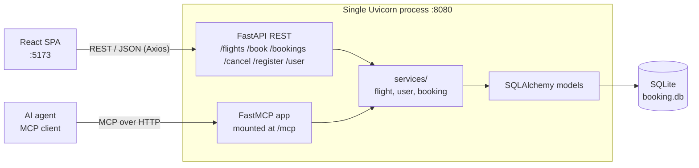
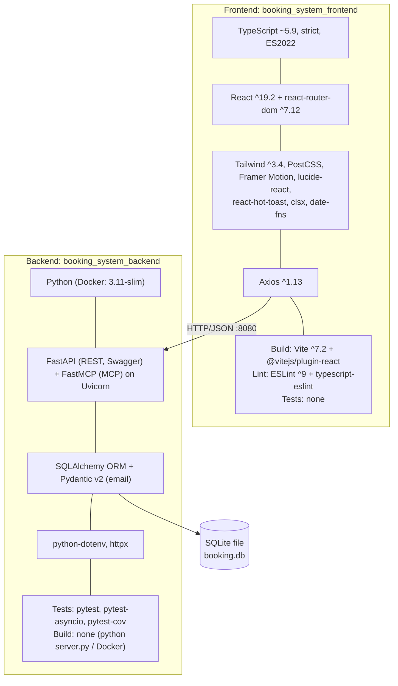
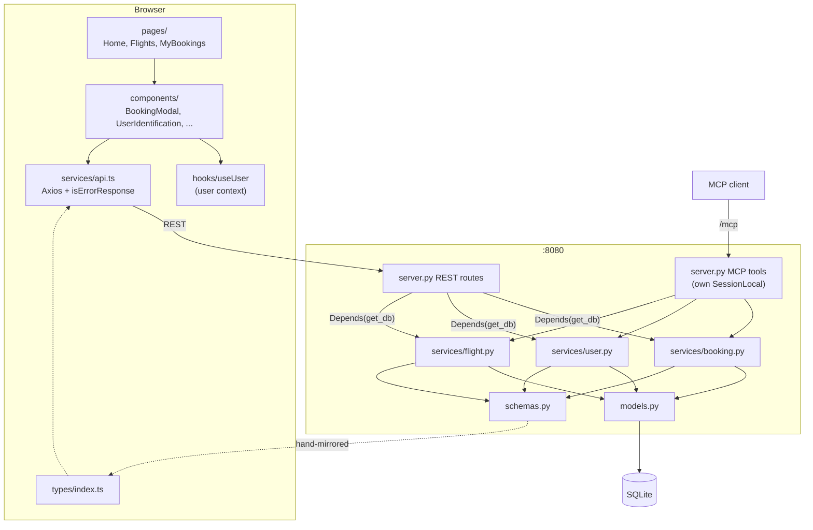
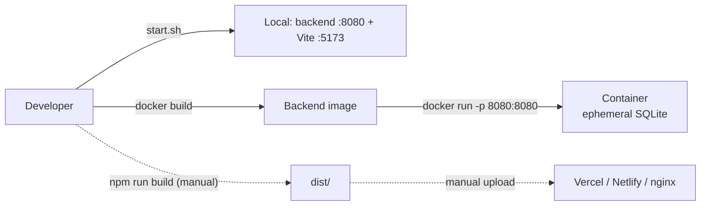

# Galaxium Travels: Onboarding Guide

Findings from analyzing the repository at branch `bob-learning-path-branch`. Everything here comes from files in the repo.

> **Missing from this checkout.** These paths were referenced but do not exist, so nothing is documented about them beyond this note:
> `booking_system_inventory_hold_service/` (Java), `tests_e2e/`, `docker-compose.yml`, `deployment_scripts/`, `terraform/`, `.github/workflows/`, a `docs/` directory (before this file), a frontend `Dockerfile`, and `start.bat`.
> If they live on another branch, re-run the analysis against it.

## Contents

1. [Application overview](#1-application-overview)
2. [Tech stack analysis](#2-tech-stack-analysis)
3. [Key components and interactions](#3-key-components-and-interactions)
4. [Unit test coverage](#4-unit-test-coverage)
5. [End-to-end test coverage](#5-end-to-end-test-coverage)
6. [Deployment model](#6-deployment-model)

---

## 1. Application overview

### Purpose

Galaxium Travels is a demo full-stack app for booking interplanetary flights between Earth, Mars, the Moon, Venus, Jupiter, Europa and Pluto. Users can:

- register or sign in with a name and email
- browse flights
- book a seat
- view their bookings
- cancel a booking

The backend exposes the same operations over **REST** (for the web UI) and **MCP** (for AI agents). The repo appears to be a tutorial or sample project for Bob.

### Project structure

```
galaxium-travels/
├── booking_system_backend/      FastAPI + FastMCP + SQLAlchemy (Python)
│   ├── server.py                REST routes, MCP tools, CORS, lifespan
│   ├── services/                booking.py, user.py, flight.py (business logic)
│   ├── models.py                ORM tables: User, Flight, Booking
│   ├── schemas.py               Pydantic request/response models
│   ├── db.py                    engine, SessionLocal, init_db, get_db
│   ├── seed.py                  demo data
│   ├── tests/                   conftest.py, test_services.py, test_rest.py
│   ├── Dockerfile, requirements.txt, pytest.ini
├── booking_system_frontend/     React 19 + TypeScript + Vite + Tailwind
│   └── src/ pages/ components/ services/ hooks/ types/ utils/
├── .bob/                        Bob modes and rules
├── internal-monologue/          per-interaction summaries (project rule)
├── start.sh                     starts both services locally
├── AGENTS.md, README.md, LICENSE, .gitignore
```

### High-level architecture



### Top-level directory responsibilities

| Path | Responsibility |
|---|---|
| `booking_system_backend/` | Python backend: REST + MCP transports, business logic, persistence, tests. |
| `booking_system_frontend/` | Web UI: routing, pages, components, API client, user session context. |
| `start.sh` | Creates the Python venv, installs dependencies, and starts the backend (:8080) and frontend (:5173). |
| `.bob/` | Bob configuration: `custom_modes.yaml` and per-mode rules. |
| `internal-monologue/` | Timestamped summaries of each interaction (required by `basic_rules.md`). |
| `AGENTS.md` | Guidance for AI agents working in the repo. |
| `README.md`, `LICENSE`, `.gitignore` | Docs, license, ignore rules. |

### Backend internals

| File | Role |
|---|---|
| `server.py` | Defines the `FastMCP` instance **before** the `FastAPI` app (required to combine lifespans), the REST routes, six `@mcp.tool()` wrappers, CORS, and the `/mcp` mount. The `lifespan` hook runs `init_db()` then `seed()` on every start. |
| `services/*.py` | All business rules. Functions **return** `ErrorResponse` instead of raising. |
| `models.py` | `User(user_id, name, email unique)`, `Flight(flight_id, origin, destination, departure_time, arrival_time, price, seats_available)`, `Booking(booking_id, user_id FK, flight_id FK, status, booking_time)`. Times are ISO strings. |
| `schemas.py` | `FlightOut`, `BookingRequest`, `BookingOut`, `UserRegistration` (`EmailStr`), `UserOut`, `ErrorResponse`. Uses Pydantic v2 `from_attributes`. |
| `db.py` | SQLite at `./booking.db`, `check_same_thread=False`. |

### Frontend internals

| Area | Role |
|---|---|
| `App.tsx` | `BrowserRouter` + `UserProvider` + `Layout`. Routes: `/` Home, `/flights`, `/bookings`, `*` falls back to Home. |
| `pages/` | `Home`, `Flights`, `MyBookings`. |
| `components/` | `layout/` (Header, Footer, Layout), `flights/`, `bookings/` (BookingCard, BookingModal), `user/` (UserIdentification), `common/` (Button, Card, Input, Modal, LoadingSpinner, Starfield). |
| `services/api.ts` | Axios client; one function per endpoint; `isErrorResponse`. |
| `hooks/useUser.tsx` | User context: `user`, `setUser`, `logout`. |
| `types/index.ts` | TypeScript mirror of backend schemas. |

### Demo data

`seed()` loads 10 users, 10 flights and 20 bookings on every startup.

---

## 2. Tech stack analysis

### Stack at a Glance



### Per-service detail

| Aspect | Backend | Frontend |
|---|---|---|
| Language | Python with type hints | TypeScript ~5.9.3 (`strict`, `noUnusedLocals`, `erasableSyntaxOnly`) |
| Runtime version | Docker uses `python:3.11-slim`; README says 3.8+; **not enforced** | README says Node 18+; **no `engines` field**; Vite 7 likely needs Node 20.19+ or 22.12+ (from memory, not verified in the repo) |
| Framework | FastAPI, FastMCP, Uvicorn | React ^19.2.0, React Router ^7.12.0 |
| Key libraries | `sqlalchemy`, `pydantic[email]`, `python-dotenv`, `httpx` | `axios`, `framer-motion`, `tailwindcss`, `lucide-react`, `react-hot-toast`, `date-fns`, `clsx` |
| Database | SQLite (`./booking.db`); `create_all` on startup; no migrations | None; talks to the backend via `VITE_API_URL` (default `http://localhost:8080`) |
| Build | None; `python server.py` or Docker | Vite; `npm run build` runs `tsc -b && vite build` |
| Test tooling | pytest, pytest-asyncio, pytest-cov | None; only `npm run lint` and the build's type check |
| Lint | none configured | ESLint 9 with react-hooks and react-refresh plugins |

### Stack concerns

- **Unpinned backend dependencies.** `requirements.txt` has no versions and there is no lock file.
- **Test packages ship with runtime packages.** pytest and its plugins are in the same `requirements.txt` as the runtime packages.
- **No `engines` declared** in `package.json`.
- **`datetime.utcnow()`** is used in the booking service, which is deprecated in recent Python versions.
- **`start.sh` needs bash**, `python3` and `node`.

---

## 3. Key components and interactions

### Component responsibilities

| Component | File | Responsibility |
|---|---|---|
| API client | `booking_system_frontend/src/services/api.ts` | Axios instance, one function per endpoint. The response interceptor rejects with `error.response.data`, or with a synthetic `NETWORK_ERROR` object. |
| Transport | `booking_system_backend/server.py` | REST routes and MCP tool wrappers, both thin; CORS; startup `init_db` + `seed`. |
| Service layer | `booking_system_backend/services/` | All business rules, returning `Model \| ErrorResponse`. |
| Persistence | `booking_system_backend/models.py` | `users`, `flights`, `bookings` tables. |
| Contract types | `schemas.py` and `types/index.ts` | Request/response shapes, **mirrored by hand**. |

### Component interaction map



### Booking lifecycle

```mermaid
sequenceDiagram
    participant UI as React UI
    participant API as api.ts
    participant S as server.py
    participant B as services/booking.py
    participant DB as SQLite

    Note over UI,DB: Identify user: POST /register or GET /user?name=&email=
    UI->>API: bookFlight({user_id, name, flight_id})
    API->>S: POST /book
    S->>B: book_flight(db, user_id, name, flight_id)
    B->>DB: flight exists? seats_available >= 1?
    B->>DB: user_id AND name match?
    B->>DB: seats_available -= 1; INSERT booking(status="booked")
    B-->>S: BookingOut or ErrorResponse
    S-->>API: HTTP 200 + JSON
    API-->>UI: Booking, or ErrorResponse (success=false)

    UI->>API: getUserBookings(user_id)
    API->>S: GET /bookings/{user_id}

    UI->>API: cancelBooking(id)
    API->>S: POST /cancel/{id}
    S->>B: cancel_booking
    B->>DB: seats_available += 1; status="cancelled"
```

**`book_flight` check order:** `FLIGHT_NOT_FOUND`, then `NO_SEATS_AVAILABLE`, then `NAME_MISMATCH` or `USER_NOT_FOUND`.
**`cancel_booking` errors:** `BOOKING_NOT_FOUND`, `ALREADY_CANCELLED`.
**`register_user` error:** `EMAIL_EXISTS`.
**`get_user` error:** `USER_NOT_FOUND`.

### Cross-service contracts to respect before changing code

| # | Contract | Why it matters |
|---|---|---|
| 1 | **Business errors return HTTP 200** with `success: false`, `error`, `error_code`, `details` in the body. | The frontend uses `isErrorResponse()` (`response.success === false`), not the HTTP status. Switching to HTTP error codes breaks every error path. |
| 2 | **Services return `ErrorResponse`; they don't raise.** | REST callers return it as-is; MCP wrappers convert it with `raise Exception(result.details or result.error)`. |
| 3 | **MCP tools open their own `SessionLocal()`** with try/finally close. | `Depends(get_db)` doesn't work outside the FastAPI request lifecycle. |
| 4 | **`FastMCP` must be created before `FastAPI`**, and `mcp.http_app()` called before `app = FastAPI(...)`. | Required to combine lifespans. |
| 5 | **`schemas.py` and `types/index.ts` are hand-mirrored.** | Nothing generates or checks one from the other. |
| 6 | **`Booking.status` is a free string.** The backend writes `"booked"` or `"cancelled"`. TypeScript also allows `'completed'`. | Mismatch is unenforced. |
| 7 | **Booking identity is `user_id` + `name`.** | A weak check, not authentication. Any caller who knows a `booking_id` can cancel it. |
| 8 | **Seat count is `Flight.seats_available`**, changed in the same transaction as the booking row. | Read, check and decrement are not atomic, so the last seat can be oversold under concurrency. |
| 9 | **Startup runs `init_db()` + `seed()` every time.** | Check `seed.py` for idempotency; tests patch `seed` to a no-op. No migrations: schema changes mean deleting `booking.db`. |
| 10 | **Pydantic v2:** use `Model.model_validate(orm_obj)`, not `.from_orm()`. | Schemas use `Config.from_attributes = True`. |
| 11 | **Tailwind tokens:** use `space-dark`, `space-blue`, `cosmic-purple`, `nebula-pink`, `alien-green`, `solar-orange`, `star-white`. | Project rule; avoid raw hex values. |
| 12 | **API base URL** comes from `VITE_API_URL`, baked in at build time. | Each environment needs its own frontend build. |

### Server hygiene issues

- `server.py` binds `uvicorn.run(..., host="0.0.0.0")`, which conflicts with the project security rule to bind to `127.0.0.1`. Binding to all interfaces is needed inside a container, so decide per environment.
- CORS is `allow_origins=["*"]` combined with `allow_credentials=True`.

### Inventory hold service

`booking_system_inventory_hold_service/` (Java, `com.galaxium.holdservice`) is **not in this checkout**. Nothing in the backend or frontend calls it. If it is added, it must coordinate with `Flight.seats_available` or take it over; otherwise holds and seat counts will drift.

---

## 4. Unit test coverage

### Overview

| Service | Framework | Test files | Status |
|---|---|---|---|
| Backend | pytest | `tests/conftest.py`, `test_services.py`, `test_rest.py`; about 26 tests | Tested |
| Frontend | None | 0 | **Untested** |
| Inventory hold service | n/a | n/a | Not in the repo |

### Backend structure

- Config in `pytest.ini`: `testpaths = tests`, `-v --tb=short`.
- `conftest.py` provides:
  - an in-memory SQLite engine with `StaticPool` (tables created and dropped per test)
  - a `db_session` fixture
  - a `client` fixture (FastAPI `TestClient`) that overrides `get_db`, patches `SessionLocal` in `db` and `server`, and no-ops `seed`
  - three sample-data fixtures, of which `sample_flight_data` and `sample_booking_data` are unused
- Test classes are grouped per feature. Each file repeats `sys.path.insert(0, parent)` because there is no package install.
- **Tests must run from `booking_system_backend/`.**

### What is tested

| File | Layer | Coverage |
|---|---|---|
| `test_services.py` | Service functions | **Flights:** empty list, list with data. **Users:** register OK, `EMAIL_EXISTS`, get OK, `USER_NOT_FOUND`. **Booking:** success with seat decrement, `FLIGHT_NOT_FOUND`, `NO_SEATS_AVAILABLE`, `USER_NOT_FOUND`, `NAME_MISMATCH`. **Cancel:** success with seat restore, `BOOKING_NOT_FOUND`, `ALREADY_CANCELLED`. **List bookings:** with data, empty. |
| `test_rest.py` | HTTP endpoints | `/flights`, `/register`, `/user`, `/book`, `/bookings/{id}`, `/cancel/{id}`, `/`. Asserts that errors return 200 with `success == False`. |

All `ErrorResponse` codes in the service layer are exercised at the service level.

### Gaps

| Priority | Gap |
|---|---|
| High | **MCP layer untested.** The six `@mcp.tool()` wrappers (error-to-exception conversion, own `SessionLocal`) and the `/mcp` mount have no tests. |
| High | **REST error paths thin.** `/book` over HTTP is tested for success and `FLIGHT_NOT_FOUND` only. `NO_SEATS_AVAILABLE`, `NAME_MISMATCH`, `USER_NOT_FOUND` and `ALREADY_CANCELLED` are untested over HTTP. The cancel success test doesn't check the seat restore. |
| Medium | **Input validation untested.** No test for an invalid email (`EmailStr`), a missing field, or a 422 response. |
| Medium | **Seat-counter edge cases.** No test for booking the last seat, cancel then rebook, or concurrency. |
| Medium | **Cross-user cancel.** No ownership check exists, and no test covers it. |
| Low | `seed.py` and `db.init_db` are never tested; `get_bookings` isn't tested for excluding other users' bookings; no coverage threshold. |

### Frontend

- No test framework: no test script, no Vitest, Jest or Testing Library, and no `*.test.*` or `*.spec.*` files under `src/`.
- The only automated checks are `npm run lint` and `npm run build` (`tsc -b` + Vite).
- **Untested critical logic:**
  - `api.ts`: the error interceptor and `isErrorResponse`
  - `useUser.tsx`: login and logout state
  - `BookingModal` and `UserIdentification`: the booking and sign-in flows
  - `MyBookings` and `Flights`: filtering and cancel handling
  - `formatters.ts`: pure functions, easy to test

### Suggested order

1. MCP tool tests, using the `fastmcp` in-process client or calling the tool functions directly.
2. The missing REST error-path tests plus a 422 validation test.
3. A last-seat and cancel-then-rebook test.
4. Add Vitest and Testing Library; start with `api.ts`, `useUser` and `formatters.ts`.

---

## 5. End-to-end test coverage

**No end-to-end or integration suite exists in this checkout.** There is no `tests_e2e/`, no Playwright, Cypress, Vitest or Jest config, no compose file, and no CI. The nearest thing is the backend `test_rest.py`, which runs in-process.

### Cross-service flow coverage

| Flow | Covered? | Where |
|---|---|---|
| Browser UI to REST (`api.ts` to FastAPI) | No | No test drives the UI or the Axios client. |
| REST endpoint to service layer to SQLite | Yes, in-process only | `test_rest.py` |
| Service layer to SQLite, directly | Yes | `test_services.py` |
| AI agent to MCP (`/mcp`) to service layer | No | No test calls a tool or the mount. |
| Full lifecycle via UI (register, book, list, cancel) | No | Pieces are tested separately on the backend only. |
| Frontend types vs backend schemas | No | Hand-mirrored with no check. |
| Booking service to inventory hold service | n/a | The service doesn't exist here. |

### What the tests assert at the boundary

`test_rest.py` asserts:

- Successes and business errors both return **HTTP 200**.
- Errors carry `success == False` and a specific `error_code`: `EMAIL_EXISTS`, `USER_NOT_FOUND`, `FLIGHT_NOT_FOUND`, `BOOKING_NOT_FOUND`.
- Success bodies contain the expected fields (`user_id`, `status` `"booked"` or `"cancelled"`, `origin` and `destination`).
- `/` returns `{"status": "OK"}`.

These assertions encode the contract `isErrorResponse` relies on. Nothing on the frontend side verifies the other half. No test checks headers, CORS, or 422 responses.

### Infrastructure the current suite needs

| Needed | Not needed |
|---|---|
| Python and pytest, run from `booking_system_backend/` | A running backend or frontend |
| FastAPI `TestClient` (in-process) | A browser |
| In-memory SQLite with `StaticPool` | Docker |
| Monkeypatches on `SessionLocal`, `get_db` and `seed` | A network port |

Because of this, the suite never exercises real HTTP, CORS preflight, the `0.0.0.0:8080` binding, the `/mcp` mount, the real lifespan with `init_db` + `seed`, or the file-based `booking.db`.

### What a real e2e suite would need

- Both servers running (via `start.sh` or compose), with a fresh `booking.db` per run, since `seed()` runs on every start.
- A browser driver (Playwright or Cypress) and a fixed `VITE_API_URL`.
- Flows to cover:
  - register or sign in, book, see it in "My Bookings", cancel, then see the seat count return on `/flights`
  - MCP tool calls against the live `/mcp`
  - UI error display for a full flight and a name mismatch
- A contract check that compares the `/openapi.json` schema with `types/index.ts`.
- If the hold service is added, contract tests for hold, confirm, release and expiry.

---

## 6. Deployment model

**Nothing beyond a backend Dockerfile exists.** There is no `docker-compose.yml`, `deployment_scripts/`, `terraform/`, `.github/workflows/` or `docs/` (before this file). Everything else below is from the READMEs and `start.sh`.

### Deployment targets

| Target | Status | Source |
|---|---|---|
| Local dev, two processes | Implemented | `start.sh`: venv, `pip install`, `python server.py` (:8080), `npm run dev` (:5173) |
| Backend Docker container | Implemented | `booking_system_backend/Dockerfile` |
| Frontend static hosting (Vercel or Netlify) | Documented only | Frontend README: `npm run build`, deploy `dist/` |
| Frontend Docker (nginx) | Documented only | Sample in the frontend README; no file in the repo. The root README's claim that both services have Dockerfiles is inaccurate. |
| Production backend via uvicorn | Documented only | Root README: `uvicorn server:app --host 127.0.0.1 --port 8080` |
| Windows launcher `start.bat` | Referenced, missing | Root README |
| Compose, Terraform, cloud, Kubernetes | None | Not in the repo |

### Containerization

**Backend**, `FROM python:3.11-slim`, then `WORKDIR /app`, `COPY . .`, `pip install -r requirements.txt`, `EXPOSE 8080`, `CMD ["python", "server.py"]`.

```
docker build -t galaxium-booking .
docker run -p 8080:8080 galaxium-booking
```

**Frontend**: no Dockerfile. The README sample is `node:18-alpine` build stage, then `nginx:alpine` serving `dist/` on port 80.

| Issue | Component |
|---|---|
| No `.dockerignore`; `COPY . .` would include `.venv`, `tests/`, any local `booking.db` | Backend |
| Test dependencies installed in the runtime image | Backend |
| Unpinned dependencies; not reproducible | Backend |
| Base image is not a Red Hat minimal image (project security rule) | Backend |
| Runs as root; no `USER` | Backend |
| SQLite inside the container, no volume; data resets on restart and `seed()` runs on every start | Backend |
| `/` health endpoint exists but no `HEALTHCHECK` | Backend |
| `VITE_API_URL` is build-time, but the sample doesn't take it as a build arg | Frontend sample |
| No SPA fallback in nginx, so `/flights` and `/bookings` return 404 on refresh | Frontend sample |

### Infrastructure provisioned

None. There are no cloud resources, no database service, no secrets management, no networking config and no Terraform. The only runtime dependency is the local SQLite file. CORS is wide open (`*` with credentials) and would need tightening for any real deployment.

### CI/CD

None. No `.github/` directory and no pipeline file for any CI system. Nothing automatically runs `pytest`, `npm run lint` or `npm run build`; nothing builds or scans images; nothing deploys. The project security rules call for SAST, dependency scanning and automated security tests in CI, and none are configured.

### Current state



Solid lines exist today; dotted lines are documented manual steps.

### Recommended next steps

1. Add a frontend `Dockerfile` with a `VITE_API_URL` build arg and an nginx SPA fallback.
2. Add a `docker-compose.yml` with a named volume for `booking.db`.
3. Harden the backend image: non-root `USER`, `.dockerignore`, split runtime and dev requirements, pin dependencies, add a `HEALTHCHECK`.
4. Add a CI workflow that runs `pytest`, `npm run lint`, `npm run build`, dependency scanning and an image scan.
5. Restrict CORS origins and decide the bind host per environment.
