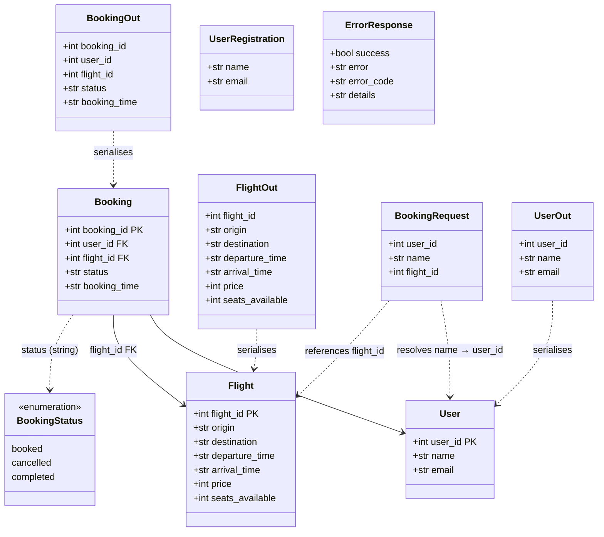

# Class Diagram

Covers the SQLAlchemy ORM models defined in `booking_system_backend/models.py`,
the Pydantic API schemas in `booking_system_backend/schemas.py`, and the
`BookingStatus` values inferred from the service and seed layers. Shows all
attributes, their types, and the relationships between classes.

