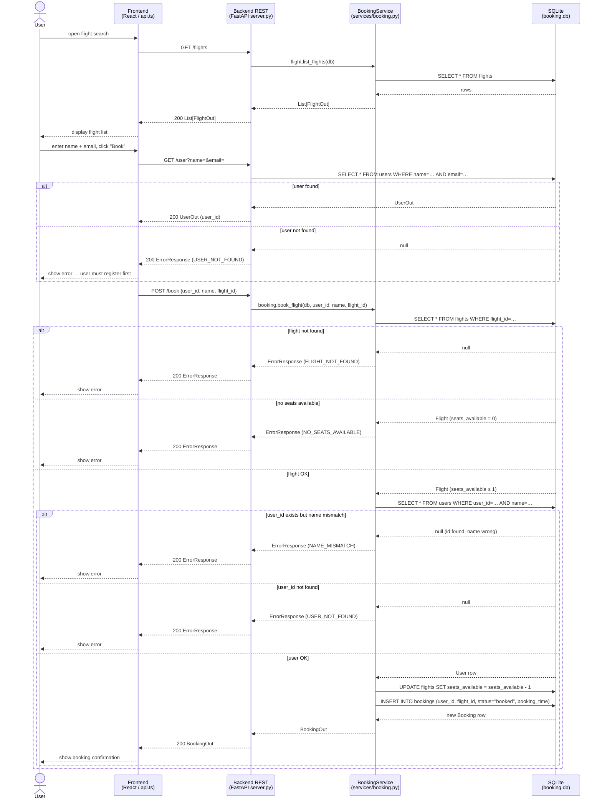

# Booking Flow Sequence Diagram

Shows the complete request/response flow for a user booking a flight, traced
across the React frontend (`booking_system_frontend/src/services/api.ts`), the
FastAPI REST layer (`booking_system_backend/server.py`), the booking service
(`booking_system_backend/services/booking.py`), and the SQLite database.
Includes all error branches: flight not found, no seats, user not found, and
name mismatch.

