# Use Case Diagram

Identifies all actors in the Galaxium Travels application and the use cases
each can perform, derived from the frontend pages
(`booking_system_frontend/src/pages/`), the FastAPI REST endpoints
(`booking_system_backend/server.py`), and the MCP tools also exposed by the
same server. Three actors are present: a **Human User** interacting through the
React SPA, a **REST Client** (e.g. Swagger UI or any HTTP client) calling
endpoints directly, and an **AI Agent** consuming the MCP tool surface mounted
at `/mcp`. Dashed arrows between MCP tools and REST endpoints reflect that both
layers call the same Python service functions in-process — the AI agent does
not make HTTP requests to the REST layer.

```mermaid
flowchart LR

    %% ── Use cases (shared nodes) ──────────────────────────────────────

    UC1["Browse home page"]
    UC2["Browse available flights"]
    UC3["Search / filter flights"]
    UC4["Sign in with name + email"]
    UC5["Register new account"]
    UC6["Log out"]
    UC7["Book a flight"]
    UC8["View my bookings"]
    UC9["Cancel a booking"]

    UC10["GET /flights — list all flights"]
    UC11["POST /register — register user"]
    UC12["GET /user — look up user by name + email"]
    UC13["POST /book — book a flight"]
    UC14["GET /bookings/&#123;user_id&#125; — get user bookings"]
    UC15["POST /cancel/&#123;booking_id&#125; — cancel booking"]
    UC16["GET / — health check"]

    UC17["list_flights MCP tool"]
    UC18["register_user MCP tool"]
    UC19["get_user_id MCP tool"]
    UC20["book_flight MCP tool"]
    UC21["get_bookings MCP tool"]
    UC22["cancel_booking MCP tool"]

    %% ── Actor: Human User (Browser) ──────────────────────────────────

    subgraph HU["👤  Human User  (Browser — React SPA)"]
        UC1
        UC2
        UC3
        UC4
        UC5
        UC6
        UC7
        UC8
        UC9
    end

    %% ── Actor: REST Client (Swagger / HTTP) ──────────────────────────

    subgraph RC["🖥️  REST Client  (Swagger UI / HTTP)"]
        UC10
        UC11
        UC12
        UC13
        UC14
        UC15
        UC16
    end

    %% ── Actor: AI Agent (MCP) ────────────────────────────────────────

    subgraph AI["🤖  AI Agent  (MCP at /mcp)"]
        UC17
        UC18
        UC19
        UC20
        UC21
        UC22
    end

    %% ── Relationships: Human User → REST endpoints ───────────────────

    UC2 -->|"GET /flights"| UC10
    UC3 -->|"GET /flights"| UC10
    UC4 -->|"GET /user"| UC12
    UC5 -->|"POST /register"| UC11
    UC7 -->|"POST /book"| UC13
    UC8 -->|"GET /bookings/&#123;user_id&#125;"| UC14
    UC8 -->|"GET /flights"| UC10
    UC9 -->|"POST /cancel/&#123;booking_id&#125;"| UC15

    %% ── Relationships: AI Agent → REST service layer (same process) ──

    UC17 -.->|"shares service layer"| UC10
    UC18 -.->|"shares service layer"| UC11
    UC19 -.->|"shares service layer"| UC12
    UC20 -.->|"shares service layer"| UC13
    UC21 -.->|"shares service layer"| UC14
    UC22 -.->|"shares service layer"| UC15
```

